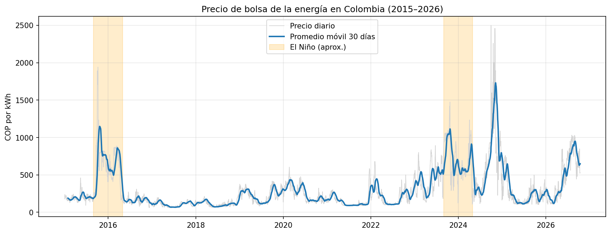
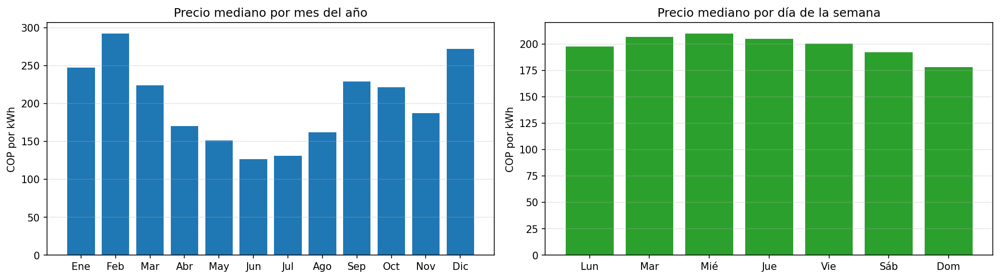
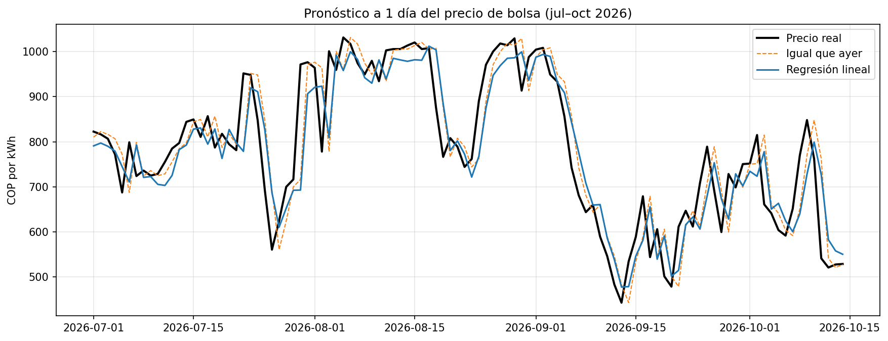

# Colombia Electricity Price Forecast

Forecasting Colombia's wholesale electricity spot price (*precio de bolsa*) using 12 years of public data from XM, the operator of the Colombian power market.

Colombia generates most of its electricity from hydropower, so droughts (like those caused by El Niño) can make prices spike. This project explores those patterns and builds a first forecasting model.

**Status:** v1 complete (exploration + 1-day-ahead forecast). v2 in progress (external drivers and longer horizons).

---

## Data

- **Source:** [XM](https://www.xm.com.co/) public API, via the official `pydataxm` library
- **Variable:** national spot price (`PrecBolsNaci`), hourly, in COP/kWh
- **Period:** Jan 2015 – Oct 2026 (4,305 days)
- **Processing:** hourly prices aggregated to daily average and daily maximum
- **Quality:** no missing days, no duplicates, no empty values

## What the data shows

- The largest spikes match **El Niño droughts** (2015–16 and 2023–24).
- The highest spike (late 2024) came **after** El Niño ended. This suggests reservoir levels matter more than the El Niño label itself, a hypothesis to test in v2.

- Prices are highest **December to March** (main dry season) and lowest in **June–July**, after the April–May rains refill the reservoirs. The effect of rain on price is **lagged**.
- **Weekends are cheaper**, because industrial and commercial demand drops.

## Forecast (v1)

**Task:** predict today's average price using only information available up to yesterday (1-day-ahead).

**Features:** price 1 and 7 days ago, 7- and 30-day rolling means (computed only with past data to avoid leakage), day of week, and month.

**Validation:** time-based split. Train on 2015–2025, test on 2026 (287 days the models never saw).

| Method | MAE (COP/kWh) | vs. naive |
|---|---|---|
| Naive ("same as yesterday") | 44.1 | baseline |
| Same day last week | 111.0 | −151.6% |
| Gradient boosting | 49.4 | −11.9% |
| Gradient boosting predicting the daily change | 46.3 | −4.9% |
| **Linear regression** | **43.2** | **+2.1%** |

### Key takeaways

- A simple **linear regression beat the naive forecast by 2.1%**, while gradient boosting did worse. More complex is not always better.
- The improvement is small. With price history alone, there is little signal beyond yesterday's price: all models follow the price one day late and cannot anticipate large moves.
- The linear model puts most of its weight on yesterday's price (coefficient 0.83), which confirms the strong inertia of the series.

## Next steps (v2)

- Add the **drivers** of price changes: reservoir levels, rainfall, the official El Niño index (ONI) and demand.
- Encode month and day of week as categories (one-hot) instead of numbers.
- Forecast **7 and 30 days ahead** and measure how the error grows with the horizon.
- Validate across several time periods (rolling backtesting), not just one test year.
- Add **prediction intervals** and a simple web demo.

## How to run

Click the **Open in Colab** badge above and run all cells. The data is downloaded directly from the XM API, so no files are needed.

## Tech stack

Python · pandas · scikit-learn · matplotlib · pydataxm · Google Colab

---

**Author:** Jose Herrera, Data Science student at Universidad de La Sabana (Bogotá, Colombia)
[LinkedIn](https://www.linkedin.com/in/joseherrera-g) · [GitHub](https://github.com/Joseherrera-G)
